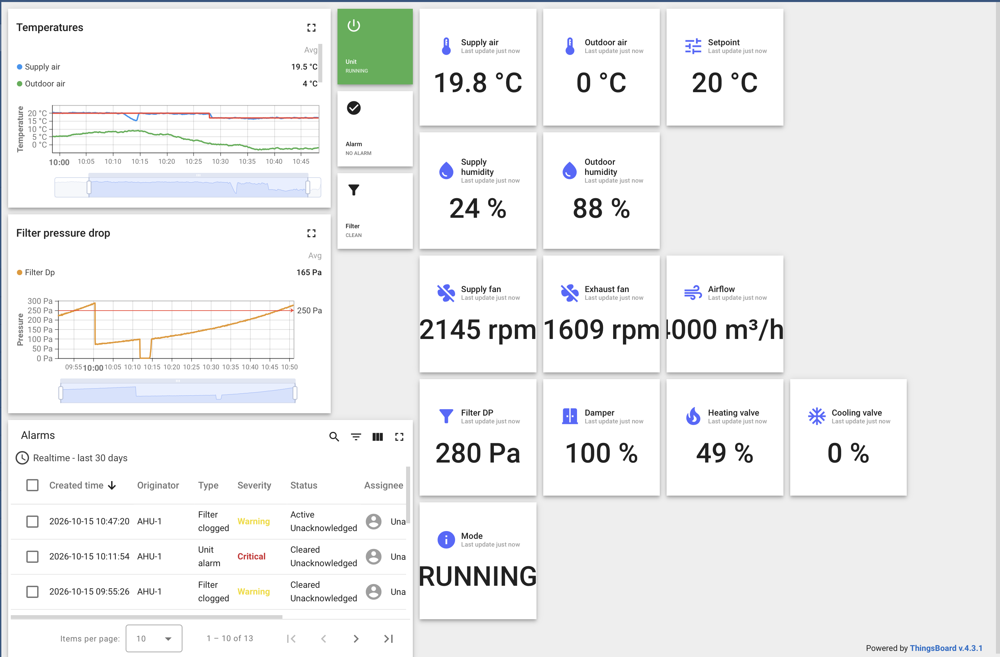

# Эмулятор приточно-вытяжной установки + ThingsBoard CE

Тестовое задание: ThingsBoard Community Edition в Docker (docker-compose), эмулятор приточно-вытяжной установки (ПВУ), который шлёт телеметрию по MQTT, и дашборд по установке.

Всё запускается локально через Docker Desktop (macOS, Apple Silicon). Доступ к внешним серверам не нужен.



## Что сделано

1. **ThingsBoard CE 4.3.1 + PostgreSQL 16** в `docker-compose.yml`: данные в именованных volumes, настройки в `.env`, `restart: unless-stopped`, healthcheck базы, ротация логов.
2. **Эмулятор ПВУ** на TypeScript (Node.js 24): физическая модель установки с регулятором, последовательностью пуска/останова, засорением фильтра и авариями. Телеметрия идёт по MQTT каждые 2 с, команды с дашборда принимаются через RPC. Запускается отдельным контейнером в том же compose.
3. **Дашборд в ThingsBoard**: текущие значения, графики температур и перепада давления на фильтре, статусы (работа, авария, фильтр) и таблица аварий. Аварии формируются правилами в профиле устройства.
4. **Скрипт `provision`** разворачивает профиль, правила аварий, устройство и дашборд на чистом ThingsBoard одной командой (экспорт лежит в `thingsboard/`).

## Структура

```
docker-compose.yml        ThingsBoard + PostgreSQL + эмулятор + one-shot provision
.env                      версии, пароли БД, токен устройства, параметры эмулятора
emulator/
  src/ahuModel.ts         физическая модель ПВУ (без зависимостей)
  src/emulator.ts         MQTT-клиент: телеметрия + RPC
  src/simulate.ts         офлайн-прогон модели без ThingsBoard
  src/provision.ts        настройка ThingsBoard через REST API
  Dockerfile
thingsboard/
  ahu-dashboard.json      экспорт дашборда
  ahu-device-profile.json профиль устройства AHU
  ahu-alarm-rules.json    правила аварий профиля
docs/                     скриншоты и запись экрана
```

## Запуск с нуля

Нужен Docker Desktop (или Docker в WSL). Команды выполняются из корня репозитория.

```bash
# 1. Инициализация БД ThingsBoard (один раз). LOAD_DEMO создаёт пользователя tenant@thingsboard.org
docker compose up -d postgres
docker compose run --rm -e INSTALL_TB=true -e LOAD_DEMO=true thingsboard

# 2. Запуск ThingsBoard (UI поднимается 1–2 минуты)
docker compose up -d thingsboard

# 3. Профиль AHU + правила аварий + устройство AHU-1 + дашборд; токен устройства пишется в .env
docker compose run --rm provision

# 4. Запуск эмулятора с новым токеном
docker compose up -d ahu-emulator
```

Дальше открыть http://localhost:8080, войти как `tenant@thingsboard.org` / `tenant`, затем **Dashboards → AHU-1 Ventilation unit**.

Остановка: `docker compose down` (данные сохраняются). Полный сброс: `docker compose down -v`.

Эмулятор можно запустить и без Docker (нужен Node.js ≥ 22.18):

```bash
cd emulator && npm ci
npm run simulate                 # офлайн-проверка модели
TB_TOKEN=<токен> npm start       # подключение к localhost:1883
```

## Настройки

### docker-compose

| Сервис | Образ | Что настроено |
|---|---|---|
| `postgres` | `postgres:16` | volume `postgres-data`, healthcheck `pg_isready`, `restart: unless-stopped` |
| `thingsboard` | `thingsboard/tb-node:4.3.1` | стартует после healthy БД; порты 8080 (UI/HTTP), 1883 (MQTT), 7070, 5683–5688/udp; `JAVA_OPTS` из `.env`; volume логов; ротация json-логов |
| `ahu-emulator` | сборка `./emulator` | подключается к `thingsboard:1883` по токену из `.env`, `restart: unless-stopped` |
| `provision` | сборка `./emulator` | профиль `setup`, запускается только вручную через `docker compose run` |

### `.env`

| Переменная | По умолчанию | Назначение |
|---|---|---|
| `TB_VERSION` | `4.3.1` | версия ThingsBoard |
| `POSTGRES_DB` / `POSTGRES_USER` / `POSTGRES_PASSWORD` | `thingsboard` / `postgres` / `postgres` | БД (только для локального стенда) |
| `TB_JAVA_OPTS` | `-Xms512M -Xmx1024M` | память JVM |
| `TB_DEVICE_TOKEN` | — | токен устройства AHU-1, заполняется скриптом `provision` |
| `PUBLISH_INTERVAL` | `2` | период отправки телеметрии, с |
| `DAY_PERIOD_MIN` | `60` | длина модельных суток, мин (ускоренное время) |
| `FILTER_LIFE_MIN` | `45` | время от чистого до засорённого фильтра при номинальном расходе, мин |
| `OUTDOOR_MEAN` / `OUTDOOR_AMPLITUDE` | `2` / `5` | средняя наружная температура и суточный размах, °C |
| `SETPOINT` | `20` | уставка температуры приточного воздуха, °C (ночью −3 °C) |
| `FAULT_RATE_PER_HOUR` | `0.5` | частота случайных отказов вентиляторов |

## Эмулятор

### Телеметрия (`v1/devices/me/telemetry`)

| Ключ | Ед. | Описание |
|---|---|---|
| `supplyTemp`, `outdoorTemp`, `setpoint` | °C | приточный воздух, наружный воздух, текущая уставка |
| `supplyHumidity`, `outdoorHumidity` | % | относительная влажность |
| `supplyFanRpm`, `exhaustFanRpm` | об/мин | обороты приточного и вытяжного вентиляторов |
| `airflow` | м³/ч | расход приточного воздуха |
| `filterDp` | Па | перепад давления на фильтре |
| `damperPos`, `heatValve`, `coolValve` | % | заслонка наружного воздуха, клапаны нагрева и охлаждения |
| `state` | — | `STOPPED` / `STARTING` / `RUNNING` / `STOPPING` / `ALARM` |
| `running`, `alarm`, `filterClogged` | bool | работа, авария, засорение фильтра |
| `alarmText`, `simTime` | — | текст аварии, модельное время суток |

### Команды (RPC `v1/devices/me/rpc/request/+`)

`getRun` / `setRun` (пуск/стоп), `getSetpoint` / `setSetpoint` (12–30 °C), `resetAlarm`, `replaceFilter`, `injectFault` (`supplyFan` / `exhaustFan` / `frost`, для демонстрации аварии).

### Почему это не случайные числа

Значения считаются физической моделью с шагом 0,5 с (`emulator/src/ahuModel.ts`):

- **Температура подтягивается к уставке.** ПИ-регулятор (Kp = 4 %/K, Ti = 60 с) управляет клапаном нагрева/охлаждения. Калорифер и датчик инерционные (звенья первого порядка, τ = 30 с и 8 с), поэтому приточный воздух выходит на уставку плавно, с небольшим перерегулированием. Ночью (22:00–07:00) уставка снижается на 3 °C, и на графике видно, как установка её отрабатывает. Чем холоднее на улице, тем сильнее открыт клапан нагрева.
- **Последовательность пуска как у реальной установки.** Сначала прогревается калорифер (положение клапана рассчитывается по наружной температуре), открывается заслонка (30 с), и только при открытой заслонке плавно разгоняются вентиляторы. При останове порядок обратный.
- **Фильтр засоряется постепенно.** Пыль накапливается пропорционально прошедшему через фильтр воздуху: когда вентиляторы стоят, фильтр не грязнеет. Перепад давления растёт квадратично с расходом: `ΔP = 70 Па · R · (Q/Qном)²`. При 250 Па выставляется `filterClogged` и срабатывает авария; через 5 минут «сервис» меняет фильтр, и перепад падает до ~70 Па. На графике получается «пила».
- **Вентилятор компенсирует засорение.** Регулирование на постоянный расход: по мере роста сопротивления фильтра обороты приточного вентилятора поднимаются примерно с 1750 до 2150 об/мин (законы подобия), расход держится на 4000 м³/ч.
- **Влажность считается через точку росы.** Абсолютное влагосодержание при нагреве сохраняется, поэтому относительная влажность приточного воздуха падает (~25 % при ~95 % на улице). Охладитель осушает воздух.
- **Погода.** Наружная температура — синусоида суточного цикла (минимум ночью, максимум около 15:00) плюс плавный случайный дрейф (процесс Орнштейна–Уленбека), без скачков.
- **Аварии.** Отказ вентилятора (случайно, примерно раз в 2 часа, или командой `injectFault`) и защита от замораживания (приток ниже 6 °C дольше 30 с). Установка останавливается и через 2 минуты автоматически сбрасывает аварию и перезапускается.

Случайность используется только для шума датчиков (±0,05 °C, ±4 об/мин), дрейфа погоды и редких отказов. Остальное следует из модели. Длительные процессы (сутки, ресурс фильтра) ускорены настройками, чтобы их было видно за время демонстрации.

## Дашборд

- **Статусы:** установка (работа/стоп), авария, фильтр (чистый/засорён).
- **Текущие значения:** температуры и уставка, влажность, обороты вентиляторов, расход, перепад на фильтре, положения заслонки и клапанов, режим.
- **Графики:** температуры (приток, улица, уставка) и перепад давления на фильтре с порогом 250 Па.
- **Таблица аварий:** аварии ThingsBoard из правил профиля AHU: `Unit alarm` (Critical, по `alarm == true`) и `Filter clogged` (Warning, по `filterClogged == true`). Обе снимаются автоматически по обратному условию.

## Сложности

- **ThingsBoard 4.4 больше не open source.** Последняя версия (4.4.0) перешла на лицензию BUSL 1.1 и при первом запуске требует активацию через License Portal. Задание про Community Edition, поэтому взята 4.3.1, последняя версия под Apache 2.0, без активации. Выяснилось только после первой установки, пришлось пересоздать БД.
- **Новый редактор правил аварий.** В 4.3 правила аварий переделаны на calculated fields (аргументы → условия), и инструкции из документации к старым версиям не подходят. Важная деталь: тип значения в фильтре должен быть Boolean, а не String, иначе условие не срабатывает.
- **Разрывы данных из-за сна Mac.** Когда ноутбук засыпает, Docker приостанавливается вместе с ним, и на графиках появляются прямые участки без данных. Для записи использовался `caffeinate -dims`.
- **Перенос дашборда на другой стенд.** Виджеты ссылаются на устройство по UUID, поэтому простой импорт JSON на чистом ThingsBoard даёт пустые виджеты. Отсюда скрипт `provision`: он создаёт устройство и подставляет его id в дашборд.
- **Настройка модели.** В первой версии при пуске приток перегревался до 37 °C: калорифер прогревался с фиксированным открытием клапана без расхода воздуха. Исправлено расчётом прогрева по наружной температуре (feed-forward) и безударным переходом на ПИ-регулятор.
- **TypeScript без сборки.** Node.js 24 запускает `.ts` напрямую (type stripping), `tsc` используется только для проверки типов. Ограничение: нельзя использовать enum и parameter properties в конструкторах.

## Скриншоты и запись

См. папку [`docs/`](docs/).
